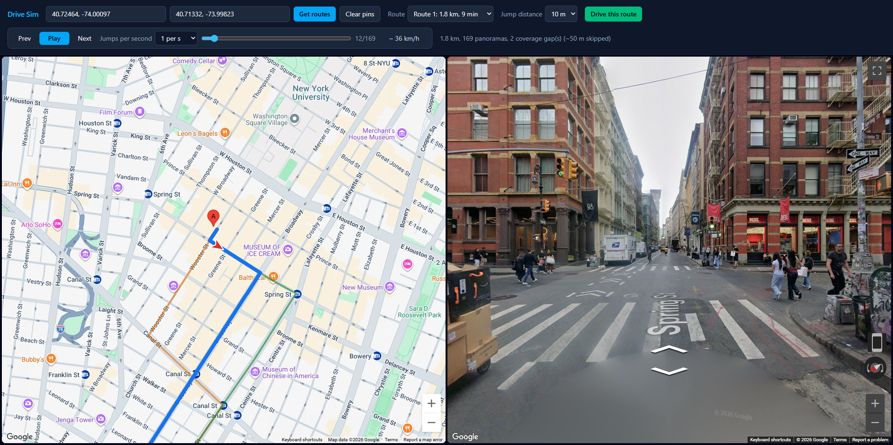

# Street View Drive Sim

Pick a start and end, get Google driving routes, choose one, and "drive" it by stepping through Street View panoramas matched to that route. The camera faces the route's direction of travel. Map on the left, Street View on the right.

## Usage

1. Click the map to drop pin **A** (start) and **B** (end), drag to adjust, or type addresses. The map starts at your current location if you allow it.
2. Press **Get routes**. All candidate routes are drawn; click one (or use the **Route** dropdown) to preview its first Street View.
3. Choose **Jump distance** (how far each view jump moves you: every panorama, or 10/25/50 m; "Every panorama" gives the smoothest transitions; applies on "Drive this route") and **Jumps per second** (applies instantly). The `~ km/h` readout is jump distance x rate.
4. Press **Drive this route**, then Play/Pause, Prev/Next or the slider. Keyboard: Space, Left/Right arrows.
5. **Reset** clears pins, routes and the Street View, and returns the map to its starting view.

## Setup

```
npm install
copy .env.example .env   # then set VITE_GOOGLE_MAPS_API_KEY
npm run dev
```

In Google Cloud (billing enabled), enable **Maps JavaScript API** and **Routes API**. Restrict the key by HTTP referrer (`http://localhost:5173/*`) and to those two APIs. The key is used client-side (no backend), so never reuse an unrestricted key. `.env` is git-ignored; never commit a real key.

Stack: Vite, plain JavaScript, Tailwind CSS v4.

## Architecture

- `src/geo.js` – distance, bearing, polyline decoding.
- `src/matcher.js` – route → panorama sequence. Pure; the panorama lookup is injected, so it can be unit-tested.
- `src/google.js` – Maps loader, Routes API `computeRoutes` call, `StreetViewService` lookup.
- `src/playback.js` – play/pause/seek/speed state.
- `src/main.js` – DOM wiring.

### Matching algorithm
1. Find the first panorama near the route start and read its links to neighbouring panoramas. Nothing else is fetched up front.
2. Repeatedly move to the linked neighbour whose heading best matches the route's direction (within 60 degrees), so each step is a real neighbour and Street View can animate the transition.
3. Reject neighbours >25 m from the route, already-visited IDs, and any that don't make forward progress along the route.
4. Heading = bearing of the route from ~8 m behind to ~15 m ahead of the panorama's projected point.
5. If no valid link exists, probe ahead on the route (up to 200 m) for a panorama; the skipped stretch is reported as a gap (never replaced with unrelated panoramas). Those jumps are hard cuts.
6. Jump distance thins the chain; "Every panorama" keeps all of it. Thinned steps are no longer neighbours, so expect more hard cuts.

The route is walked lazily: about 20 steps are loaded to start, and more load in the background as playback nears the end of what's loaded. API calls are therefore only spent on the part you actually drive. The slider covers only what's loaded so far.

The older sample-and-lookup matcher (`matchRoute`) is still in `matcher.js` but unused.

## Known limitations
- Origin/destination can be typed addresses or map pins; no Places Autocomplete yet.
- Links are followed greedily by heading; at complex intersections or with opposite carriageways close together it can still pick a wrong branch.
- Following links is sequential (about one API call per panorama driven); panoramas ahead of the playhead are loaded in small batches.
- Playback jumps between panoramas; no interpolation.
- Panoramas can be older imagery or user-contributed; the OUTDOOR source filter reduces but doesn't eliminate that.
- Don't persist/cache panorama data beyond the session (Maps Platform terms).


## Screenshot


