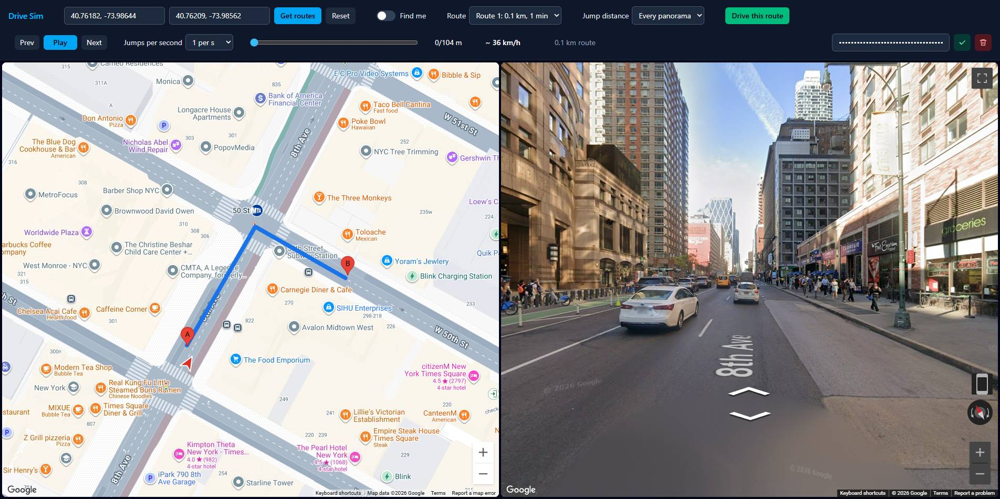

# Street View Drive Sim

Pick a start and end, get Google driving routes, choose one, and "drive" it by stepping through Street View panoramas matched to that route. The camera faces the route's direction of travel. Map on the left, Street View on the right.

## Usage

1. Enter your Google Maps API key in the **API key** field in the header and press the green check to save it (the trash icon deletes it). It is stored only in your browser's localStorage and is never part of the build. See [Getting an API key](#getting-an-api-key).
2. Click the map to drop pin **A** (start) and **B** (end), drag to adjust, or type addresses. The map starts at Times Square; tick **Find me** to center it on your location.
3. Press **Get routes**. All candidate routes are drawn. Click one (or use the **Route** dropdown) to preview its first Street View.
4. Set **Jump distance** (every panorama, or 10/25/50 m) and **Jumps per second**. "Every panorama" gives the smoothest transitions. Jump distance takes effect when you press **Drive this route**; speed changes apply immediately. The `~ km/h` readout is jump distance x rate.
5. Press **Drive this route**, then use Play/Pause, Prev/Next or the slider. Keyboard: Space, Left/Right arrows.
6. **Reset** clears pins, routes and the Street View, and returns the map to its starting view.

## Setup (optional, to run locally)

```
npm install
npm run dev
```

Stack: Vite, plain JavaScript, Tailwind CSS v4.

## Getting an API key

1. Open the [Google Cloud Console](https://console.cloud.google.com/) and create or select a project.
2. Enable billing for the project (required by Google Maps Platform, which includes a monthly free usage allowance).
3. Under **APIs & Services > Library**, enable **Maps JavaScript API** and **Routes API**.
4. Under **APIs & Services > Credentials**, choose **Create credentials > API key**.
5. Edit the key and restrict it, since it is used client-side and visible to anyone using the app:
   - **Application restrictions:** HTTP referrers. Add `http://localhost:5173/*` for local use or `https://akinuri.github.io/*` if using the live demo.
   - **API restrictions:** restrict to Maps JavaScript API and Routes API.
6. Paste the key into the app's **API key** field, either locally or on the live demo at https://akinuri.github.io/street-view-drive-sim/ (it is already deployed; the key stays in your own browser).

## Architecture

- `src/geo.js` – distance, bearing, polyline decoding.
- `src/matcher.js` – route → panorama sequence, independent of the UI (panorama lookup is injected).
- `src/google.js` – Maps loader, Routes API `computeRoutes` call, `StreetViewService` lookup.
- `src/playback.js` – play/pause/seek/speed state.
- `src/main.js` – DOM wiring.

### Matching algorithm
1. Find the first panorama near the route start and read its links to neighbouring panoramas. Nothing else is fetched up front.
2. Repeatedly move to the linked neighbour whose heading best matches the route's direction (within 60 degrees), so each step is a real neighbour and Street View can animate the transition.
3. Reject neighbours >25 m from the route, already-visited IDs, and any that don't make forward progress along the route.
4. Heading = bearing of the route from ~8 m behind to ~15 m ahead of the panorama's projected point.
5. If no valid link exists, probe ahead on the route (up to 200 m) for a panorama; the skipped stretch is reported as a gap (never replaced with unrelated panoramas). Those jumps are hard cuts.
6. Jump distance thins the chain; "Every panorama" keeps all of it. Thinned steps are no longer neighbours, so expect more hard cuts.

The route is walked lazily: about 20 steps are loaded to start, and more load in the background as playback nears the end of what's loaded. API calls are therefore only spent on the part you actually drive. The slider covers only what's loaded so far.

Before a sharp turn, the camera rotates in place before moving to the next panorama, so the turn and the Street View transition don't overlap.

## Deploying to GitHub Pages

Pushing to `main` builds the app and publishes it via `.github/workflows/deploy.yml`. One-time setup: in the repo, go to Settings > Pages and set **Source** to **GitHub Actions**. Add `https://<user>.github.io/*` to the key's allowed HTTP referrers. Each visitor enters their own key in the app.

## Known limitations
- Origin/destination can be typed addresses or map pins; no Places Autocomplete yet.
- Links are followed greedily by heading; at complex intersections or with opposite carriageways close together it can still pick a wrong branch.
- Following links is sequential (about one API call per panorama driven); panoramas ahead of the playhead are loaded in small batches.
- Playback jumps between panoramas; no interpolation.
- Panoramas can be older imagery or user-contributed; the OUTDOOR source filter reduces but doesn't eliminate that.
- Panorama data is not stored beyond the session, in line with Maps Platform terms.

## Screenshot


